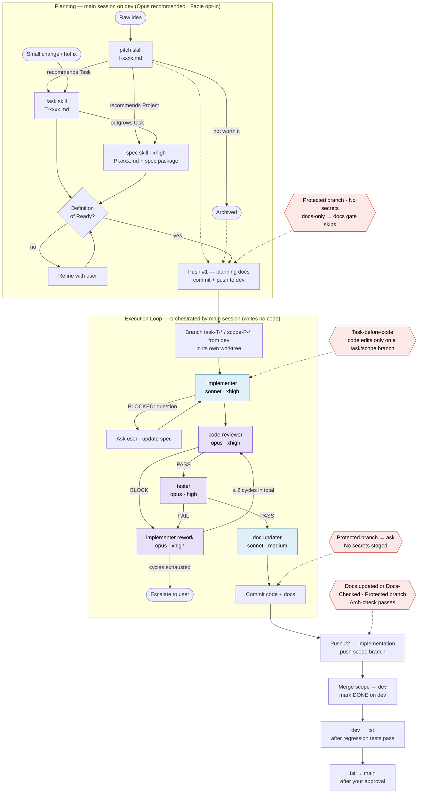

# Claude Code Project Template

A ready-to-use template for coding projects using [Claude Code](https://claude.ai/code). It bundles the `CLAUDE.md` project instructions, custom agents, skills, hooks, and doc templates I use across all my projects.

## What's included

| Path | Purpose |
|------|---------|
| `CLAUDE.md` | Project instructions loaded by Claude Code at session start — covers the Execution Loop, branching and worktrees, environments, testing, memory, logging, and hard gates |
| `.claude/agents/` | Subagents with pinned models: `implementer` (sonnet — writes the code), `code-reviewer` (opus), `tester` (opus), `doc-updater` (sonnet) |
| `.claude/skills/` | Skills: `pitch` (idea refinement), `task` (ready-to-implement tasks, small changes, hotfixes), `spec` (project specification), `glossary` (ubiquitous language), `arch-check` (architecture invariants), `deployment-process`, `share` (shareable HTML mini-sites from docs), `template-sync` |
| `.claude/hooks/` | Hard gates: docs updated before push, protected branches ask, no secrets in git, no code outside a task/scope branch, architecture check before push |
| `.claude/settings.json` | Claude Code settings |
| `.githooks/` | `pre-commit` secrets backstop for commits made outside Claude Code |
| `docs/templates/` | Starter templates for `SYSTEM.md`, tasks, index files, test registry, deploy secrets, and the arch-check CI workflow |

## Usage

1. Copy the `Template/` folder into a new project root and create the `dev` branch — the primary checkout stays on it.
2. Fill in `docs/templates/SYSTEM.template.md` → `docs/SYSTEM.md` (project-specific instructions go there, not in `CLAUDE.md`).
3. Add `.env` and `docs/local/deployment.md` (both gitignored), and run `git config core.hooksPath .githooks`.
4. To update an existing project, run the `template-sync` skill. Upgrading from 0.x: run it twice — see `Template/.claude/skills/template-sync/MIGRATIONS.md`.

## Work artifact flow

```
Pitch (I-xxxx.md) → Task (T-xxxx.md) → Project (P-xxxx.md)
```

Ideas are refined with `/pitch`, scoped into tasks (`/task`) or projects (`/spec`) on `dev`, implemented in a worktree per task/scope branch, and promoted through `dev → tst → main`.

## Workflow and model routing (v1.0.0)

Opus plans and judges; Sonnet codes against tightly defined scopes. Planning runs in the main session (model chosen by you — Opus recommended, Fable opt-in). Coding, review, and testing run in subagents with pinned models. Hexagons are hard gates enforced by hooks. The primary checkout always stays on `dev`, where every planning doc (pitches, tasks, projects/specs) is committed and pushed as it is written. Code never goes to `dev` directly: every change, however small, gets a task (`T-xxxx.md`) or project scope and is built in its own worktree on a branch created from `dev`, then merged back.

**Definition of Ready** — a task or scope reaches the implementer only when it has: goal, files/modules it touches (with a pattern reference), task checklist, declarative acceptance criteria, OUT-of-scope constraints, and no open questions.


